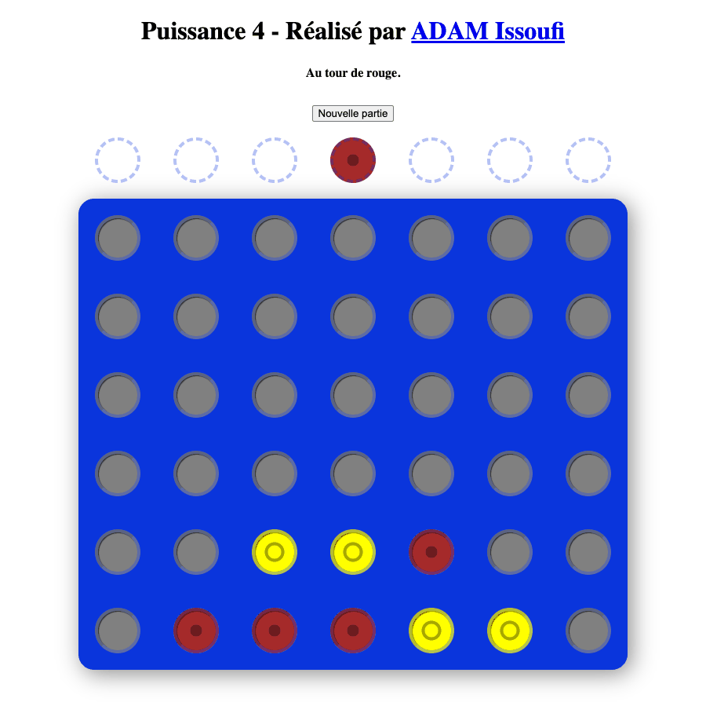

# Connect Four

A two-player Connect Four game in the browser, played through a small REST API that runs on a
Cloudflare Worker.

- Play it: <https://connect-four.issoufi.fr>
- API docs: <https://connect-four.issoufi.fr/api/v1/>



## How to play

Two players share the same screen and take turns, red first. Click one of the seven dashed
circles above the board to drop a token of the current player in that column: it falls to the
lowest free cell. The first player who aligns four tokens, in a row, a column or a diagonal,
wins. When the 42 cells are full with no alignment, the game is a draw.

Above the board, the page says whose turn it is, then who won or that the game is a draw. It
shows why a move cannot be played, such as a full column, whose circle is grayed out, or a game
that is over. Each visitor plays their own game: the Nouvelle partie button, or reloading the
page, starts a new one.

The page can also be played on a phone, with the keyboard alone and with a screen reader:

- It fits a phone screen of 375 px wide.
- Keyboard: Tab reaches the columns, the left and right arrows, Home and End move between them,
  and Enter or Space drops a token.
- Screen readers announce each column and each cell of the board, such as "Ligne 3, colonne 2 :
  rouge", and read whose turn it is and the messages as they change.
- A dot marks the red tokens and a ring the yellow ones, so they are told apart without color.

## Stack

- [Express 5](https://expressjs.com/) serves the API, on a
  [Cloudflare Worker](https://developers.cloudflare.com/workers/) with the `nodejs_compat` flag.
- Each game lives in its own [Durable Object](https://developers.cloudflare.com/durable-objects/),
  which deletes it 7 days after its start or its last move.
- A rate limit lets each IP address start 20 games a minute.
- The page is plain HTML, CSS and JavaScript, with no build step.
- [Vitest](https://vitest.dev/) runs the tests, ESLint 10 and Redocly CLI lint the code and the
  OpenAPI document, and GitHub Actions runs them on every pull request.
- [pnpm 12](https://pnpm.io/) installs the dependencies.

[docs/decisions/](docs/decisions/) records why, one decision per file.

## API docs

`/api/v1/` shows the docs of the API with Swagger UI, from the OpenAPI 3.1 document
`public/api/v1/openapi.yaml`. Keep that document in step with the routes of `routes/index.js`.

The page loads Swagger UI from jsDelivr, at the version of the `swagger-ui-dist` devDependency of
`package.json`, which Dependabot bumps in a pull request of its own. That pull request fails
`index.test.js` until the two links of `public/api/v1/index.html` take the new version and the
SRI hashes of its files.

## Game API

- `POST /game` starts a game. It returns `201` with the game, whose `id` the other routes take,
  and a `Location` header to read it. Each IP address may start 20 games a minute: beyond, it
  returns `429 { "message": "..." }`.
- `GET /game/{gameId}/status` returns the game: its `id`, the `players`, the `tokens` left,
  `lastPlayerWhoPlayed`, `winner` (`no winner` until a player aligns four tokens), `state`
  (`playing`, `won` or `draw`) and the `board`, top row first.
- `POST /game/{gameId}/play` plays the move of its JSON body, `{ "playerId": "red", "column": 1 }`:
  a token of `red` or `yellow` in a column from 1 to 7. It returns the new status. A bad body or
  a move that breaks a rule (game over, not the player's turn, full column) returns
  `400 { "message": "..." }` and leaves the game unchanged.

An id that no game has, or a route that does not exist, returns `404 { "message": "..." }`. A
game is deleted 7 days after its start or its last move, so its id then returns `404` too.

## Architecture

The site is a [Cloudflare Worker](https://developers.cloudflare.com/workers/), described by
`wrangler.jsonc`:

- Cloudflare serves the files of `public/` (the page, its scripts, its favicon and the API docs)
  before the Worker runs. `public/.assetsignore` keeps the tests of the page helpers out of it.
- `public/_headers` adds security headers to these files. Its Content-Security-Policy only allows
  the site itself and forbids other sites to frame the pages, and `/api/v1/` has its own to load
  Swagger UI from jsDelivr. Its Strict-Transport-Security keeps browsers on HTTPS for a year, for
  this host alone. The JSON answers of the Worker do not get these headers: the Express app sends
  them only `X-Content-Type-Options` and `Strict-Transport-Security`.
- The page loads `public/main.js` as an ES module, which draws the game. It calls the API through
  `public/api.js`, imports its rules from `public/utils.js`, and writes its texts with
  `public/texts.js` from the copy of `public/constants.js`.
- `index.js` runs the Express app of `routes/` on the Worker, with the `nodejs_compat` flag.
- Each game lives in its own [Durable Object](https://developers.cloudflare.com/durable-objects/)
  (`worker/Game.js`), which saves its moves and plays them again in the engine of `app/` when it
  wakes up. The engine does not depend on Express or on Cloudflare. An alarm of the Durable
  Object deletes the game 7 days after its start or its last move.
- The [Rate Limiting binding](https://developers.cloudflare.com/workers/runtime-apis/bindings/rate-limit/)
  `GAME_START_LIMITER` counts the games that each IP address starts.

[docs/decisions/0002](docs/decisions/0002-host-on-a-cloudflare-worker-with-durable-objects.md)
explains these choices.

## Run locally

```sh
pnpm install --frozen-lockfile
pnpm dev
```

It needs [pnpm](https://pnpm.io/installation): any installed version switches by itself to the
one that the `packageManager` field of `package.json` pins. pnpm only installs versions published
at least 7 days earlier, except the exclusions that `pnpm-workspace.yaml` lists, and runs no
install script of a dependency. The `overrides` of that file force the security fixes that a
dependency does not take yet: each one, and each exclusion made for such a fix, says when to
remove it.

`pnpm dev` runs the Worker, its files and its Durable Objects with `wrangler dev`, at
<http://localhost:8787> by default, and keeps the games in `.wrangler/`.

## Deploy

[Workers Builds](https://developers.cloudflare.com/workers/ci-cd/builds/) deploys `master` on
Cloudflare after each merge, on the custom domain `connect-four.issoufi.fr`. It installs the
dependencies with pnpm, from `pnpm-lock.yaml`, and its `PNPM_VERSION` build variable must follow
the `packageManager` field of `package.json`.

`pnpm run deploy` deploys the Worker by hand with `wrangler deploy` (`pnpm deploy` is a command of
pnpm itself). It needs a Cloudflare account that holds the `issoufi.fr` zone: log in with
`pnpm exec wrangler login`, or set `CLOUDFLARE_API_TOKEN` and `CLOUDFLARE_ACCOUNT_ID`. The Worker
needs no build step, no variable and no secret.

### Previews

Workers Builds deploys each push to another branch as a
[Preview](https://developers.cloudflare.com/workers/previews/), with `wrangler preview`, when
**Enable Preview Builds** is on (Settings > Build > Branch control of the Worker). Its pull
request gets:

- a `Workers Builds: connect-four` check;
- a comment with the Preview URL, `<branch>-connect-four.<subdomain>.workers.dev`, which serves
  the last commit of the branch, and the URL of each deployment.

These URLs are public and send an `X-Robots-Tag: noindex` header.

A Preview inherits none of the production bindings: the `previews` block of `wrangler.jsonc`
gives it `GAMES` and `GAME_START_LIMITER` bindings apart from those of production.

- Cloudflare gives each Preview its own Durable Object storage, so a Preview never reads or
  writes the production games.
- The limit of 20 started games a minute counts on the rate limit namespace `1002`, which all the
  Previews share, apart from the `1001` of production.

`preview_urls` turns these workers.dev URLs on. It also turns on the
[Version URLs](https://developers.cloudflare.com/workers/versions-and-deployments/version-urls/)
of the production versions, which run with the production games and limit, like the site.

`pnpm exec wrangler preview` deploys the current branch by hand, with the account of
`pnpm run deploy`, and `pnpm exec wrangler preview delete --name <branch>` deletes a Preview.
Past the limit of the plan (100 Previews on the Free plan), Cloudflare deletes the Preview
deployed to least recently.

## Run the tests

`pnpm test` runs the Vitest tests:

- the engine (`app/`), the routes (`routes/`) and the storage of the games (`worker/`), with fake
  Durable Objects;
- the helpers of the page (`public/utils.test.js`, `public/texts.test.js`) and its calls to the
  API (`public/api.test.js`), with a fake `fetch`;
- the page script (`public/main.test.js`), run on the elements of `index.html` in a
  [jsdom](https://github.com/jsdom/jsdom) document with a fake `fetch`;
- the whole Worker (`index.test.js`), run in the local Workers runtime by `createTestHarness` of
  Wrangler, with its files and its Durable Objects;
- the commit message checks, which call Git.

They need Node.js 22.22.2+, 24.15+ or 26+ (the `engines` field of `package.json`): the versions
that jsdom supports. `.nvmrc` gives the version used in development and in the CI: 24, an LTS
release.

## Lint

`pnpm lint` runs both checks, and fails on any error or warning:

- `pnpm lint:js` checks every JavaScript file with ESLint 10 and its flat configuration,
  `eslint.config.js`: the recommended rules, plus the rules of Airbnb base that the code was
  written against, the layout ones from [ESLint Stylistic](https://eslint.style/). The
  scripts of `public/` are linted with the browser globals, the page ones as ES modules, and the
  other files with the Node.js ones.
- `pnpm lint:api` checks the OpenAPI document with the recommended rules of
  [Redocly CLI](https://redocly.com/docs/cli/), each warning made an error (`redocly.yaml`).
  `.redocly.lint-ignore.yaml` lists the problems ignored on purpose, each with its reason.

## Continuous integration

GitHub Actions runs `.github/workflows/ci.yml` on every pull request, every push to `master`,
and on `master` every Monday at 05:23 UTC:

- `pnpm install --frozen-lockfile`, `pnpm audit --audit-level moderate`, `pnpm lint` and
  `pnpm test` on the Node.js version of `.nvmrc`;
- `pnpm install --frozen-lockfile` and `pnpm test` on Node.js 22 and 26: the oldest major release
  that `engines` accepts and the newest one released. Dependabot does not update this matrix:
  add each new major release of Node.js to it by hand.

The audit fails the run on any advisory at or above moderate:

- it replaces the security alerts of Dependabot, which never fire here: GitHub's dependency graph
  reads only the first YAML document of `pnpm-lock.yaml`, which pnpm 12 fills with pnpm itself
  and its binaries alone;
- the weekly run catches a new advisory, or a drift of the tools, without waiting for a pull
  request;
- like the live check below, a failed weekly run is e-mailed to the user who last changed the
  `cron`, and GitHub turns the schedule off after 60 days without activity: turn it back on with
  "Enable workflow" in the Actions tab.

Each job sets pnpm up with `pnpm/action-setup`, which reads the `packageManager` field. It is
pinned to the commit of v6.1.0, the first release that starts from pnpm 12 instead of 11, since
its `v6` tag still points to v6.0.10.

`.github/workflows/commit-messages.yml` checks the commit messages of every pull request, and
its title unless a bot opened it, with commitlint (see [Commit messages](#commit-messages)).

`.github/workflows/live-check.yml` runs `scripts/live-check.sh` against the live site every day
at 06:17 UTC:

- it requests the page, its script and the API docs, then starts a game, reads its status and
  plays a first move, and prints each request;
- to run it by hand, click "Run workflow" on the workflow in the Actions tab, with a `host` input
  (`connect-four.issoufi.fr` by default), or run `scripts/live-check.sh [host]` with `curl` and
  `jq`;
- a failed run shows in the Actions tab, and GitHub e-mails it to the user who last changed the
  `cron` of the workflow;
- GitHub turns the schedule off after 60 days without activity in the repository: turn it back
  on with "Enable workflow" in the Actions tab;
- each run starts one game, which counts against the start rate limit: keep it daily and never
  run it in a loop.

Dependabot checks the npm packages and GitHub Actions every week, for releases at least a week old
(`.github/dependabot.yml`): one pull request for the npm minor and patch updates, one for the
GitHub Actions updates, and one alone for `swagger-ui-dist` (see [API docs](#api-docs)). It
proposes no npm major update: each one goes through its own ticket.

## Commit messages

Every new commit follows [Conventional Commits](https://www.conventionalcommits.org/) and names
its ticket in a trailer:

```text
feat: add a New game button

Refs: C4-14
Co-Authored-By: …
```

- `Refs: C4-<n>` sits in the last paragraph, with no blank line before `Co-Authored-By:`.
- commitlint checks each commit in the `commit-msg` Git hook, and in the CI. The CI also checks
  the title of a pull request, without the trailer, unless a bot opened it.
- Merge commits and the commits of Dependabot and release-please are not checked.
- `pnpm install` sets up the hooks with Husky. On a branch named after a ticket, such as `C4-20`,
  the `prepare-commit-msg` hook adds `Refs: C4-20` to a message that has no `Refs:` line yet.

## History

[docs/evolution.md](docs/evolution.md) tells how the stack changed, with figures, and
[docs/decisions/](docs/decisions/) keeps one record per decision.
[docs/ai-workflow/](docs/ai-workflow/overview.md) explains how agents work on the project, and
with which tools.
